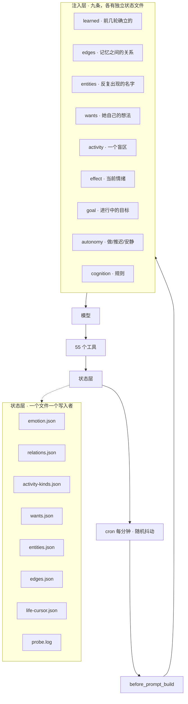
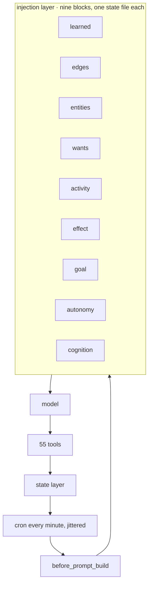

# Architecture / 技术架构

[简体中文](#简体中文) · [English](#english)

---

## 简体中文

> 一个 agent、一个工作区、一个进程。所有东西都是磁盘上的文件，没有藏在服务里。

### 总览



### 分层

```
extensions/dafeiyu-core/        代码 —— 无状态，可重启
workspace/                      她的状态 —— 必须活下来的东西
workspace/memory/YYYY-MM-DD.md  日记，一行一件事，只追加
workspace/state/*.json          结构化状态，一个文件一件事
```

**重要的东西都不在进程里。** 重启只丢正在处理中的东西，她从最后落盘的状态继续。这才是让一个 6,900 行的插件可以被安全杀掉的前提。

### 状态归属

每个文件一个写入者。多个读者没问题；多个写入者会静默丢字段。

| 文件 | 写入者 | 内容 |
|---|---|---|
| `state/emotion.json` | `effect-ledger.js` | 情绪向量，读时衰减 |
| `state/relations.json` | `relations.js` | 熟悉度、信任、互动次数 |
| `state/activity-kinds.json` | `activities.js` | 每类的接触 / 完成 / 失败 |
| `state/wants.json` | `wants.js` | 她自己的想法 |
| `state/entities.json` | `entities.js` | 名字 → 记忆 |
| `state/edges.json` | `edges.js` | 记忆 ↔ 记忆，带原因 |
| `state/life-cursor.json` | `life-log.js` | 日记读到哪了 |
| `state/probe.log` | 所有注入器 | 每条注入一行，只追加 |

`deeds.json`、`effects.json`、`experience-pool.json` 目前有多个写入者，是已知
弱项。见 `docs/LESSONS.md` 第四条。

### 好奇心为什么是一个独立层

好奇心不是"另一个待办清单"，它是唯一一个**无法靠指令驱动**的机制。

别的层都能由 prompt 推动："去做 X"、"别做 Y"、"想想 Z"。
但"你不知道什么"这件事没有答案 —— 你不知道该去查什么，
因为你不知道你不知道。

所以它只能靠**被动捕获**：在真实的卡顿发生时记录。

```
工具调用失败或返回空
   ↓  after_tool_call（纯观察，不改结果）
抽取候选 ── 提问 / 回忆 / 搜索 / 浏览
   ↓  已知词过滤（否则会把已知的东西重新记为缺口）
去重合并（同一话题加一笔，不新增一条）
   ↓
urgency 排序 ── 次数 0.42 / 新鲜 0.30 / 置信 0.28 / 未提过 0.08
   ↓
注入（每次最多一条）
```

三个刻意的约束：

**① 每个来源独立开关。** 一个来源可以是纯噪声，另一个是精确的。共用开关会导致
为了关掉噪声而丢掉信号。

**② `resolved` 与 `dropped` 分开统计。** 放弃是正当结局，但不能看起来像学会。
系统分开记，就是为了不让"把记录划掉"伪装成"弄明白了"。

**③ 抽取器是纯函数，不碰状态。** `curiosity-extract.js` 只做字符串 → 候选的映射，
所有写入在 `curiosity.js`。这让抽取规则可以被单元测试完全覆盖。

**为什么浏览来源默认关闭** —— 实测 29 条真实记录，触发 3 条，造出 4 个词，
全部是它本来就认识的。一条假缺口的代价高于十条缺失：
它会让整个清单被判定为噪声，然后连真的也不看了。

### 为什么注入要排序

这些块不是互相独立的。`activity-inject` 提出盲区，`autonomy-inject` 才判断这轮
有没有空花在它上面。情绪（`effect-inject`）影响一个提议读起来像邀请还是像任务。
顺序错了会出现「候选还不存在就做了决定」的轮次。

### 为什么提示词是独立文件

`prompt-COGNITION.md`（20 KB）放规则：每个工具干什么、什么时候不用、什么算正当结果。
放在代码外面，意味着行为可以重写而不动运行时，代码可以重构而不改她的性格。

它由插件注入，而不是当作引导上下文加载——OpenClaw 只自动加载工作区里固定白名单
的文件。自定义提示词必须在 `before_prompt_build` 里显式推进去，按 mtime 缓存，
避免每轮重读。

### 工具是干什么的

五十五个工具，按它们碰的状态分组：

```
emotion_state · emotion_nudge            情绪
remember_about · recall_about · who_is   事实与人
want_do · activity_state                 她自己的意图与历史
recall_links                             记忆遍历
note_diary · note_self · note_effect     写回
goal_add · goal_step · goal_close        长期目标
intent_outcome · experience_resolve      闭环
dafeiyu_voice · dafeiyu_sticker          表达
```

工具是模型「写」的方式，注入是它「读」的方式，两边走同一批状态文件。

### 值得刻意防的失败模式

**静默空转。** 接在一个永不触发的钩子上的功能，和一个能用的功能看起来完全一样，
直到你去看探针日志。所以每个注入器无条件写一行，包括空路径——**没有这一行，
意思是钩子没跑，而不是没什么可说**。

**有打分没行动。** 一个阈值可以过滤掉整个候选列表，然后读起来像「无事可做」。
要同时记录被过滤掉的东西，不只是通过的。

**看起来很合法的状态。** 停在 0 的游标解析正常。字段名写错的 JSON 仍然是合法
JSON。要校验含义，不是语法。


---

## English

> One agent, one workspace, one process. Everything is a file on disk; nothing is
> hidden in a service.

### Overview



### Layers

```
extensions/dafeiyu-core/        code — stateless, restartable
workspace/                      her state — what must survive
workspace/memory/YYYY-MM-DD.md  diary, one line per event, append-only
workspace/state/*.json          structured state, one file per concern
```

**Nothing important lives in the process.** A restart loses only what was in
flight; she resumes from the last written state. That is what makes a 6,900-line
plugin safe to kill.

### State ownership

Each file has one writer. Multiple readers are fine; multiple writers silently
lose fields.

| File | Writer | Contents |
|---|---|---|
| `state/emotion.json` | `effect-ledger.js` | mood vector, decays on read |
| `state/relations.json` | `relations.js` | familiarity, trust, interactions |
| `state/activity-kinds.json` | `activities.js` | exposure / done / failed per kind |
| `state/wants.json` | `wants.js` | her own open intentions |
| `state/entities.json` | `entities.js` | names → memories |
| `state/edges.json` | `edges.js` | memory ↔ memory with a reason |
| `state/life-cursor.json` | `life-log.js` | how far into the diary we have read |
| `state/probe.log` | all injectors | one line per injection, append-only |

`deeds.json`, `effects.json` and `experience-pool.json` currently have more than
one writer and are the known weak point. See [LESSONS.md](docs/LESSONS.md), #4.

### Why curiosity is its own layer

Curiosity is not "another to-do list". It is the only mechanism here that
**cannot be driven by instruction**.

Every other layer can be pushed by prompt: "go do X", "stop doing Y", "think about Z".
But "what you don't know" has no answer — you don't know what to look up
because you don't know that you don't know it.

So it can only work by **passive capture**: record the gap when the friction
actually happens.

```
tool call fails or returns empty
   ↓  after_tool_call (observe-only, never changes the result)
extract candidates ── question / recall / search / browse
   ↓  known-term filter (else it re-mints things she already knows)
merge duplicates (same topic increments, does not add a row)
   ↓
urgency ranking ── count 0.42 / freshness 0.30 / confidence 0.28 / unproposed 0.08
   ↓
inject (at most one per wake)
```

Three deliberate constraints:

**① Independent kill switch per source.** One source can be pure noise while
another is precise. A shared switch forces you to lose the signal to silence the noise.

**② `resolved` and `dropped` are counted separately.** Giving up is a legitimate
outcome, but it must not look like learning.

**③ The extractor is pure.** `curiosity-extract.js` only maps strings to candidates;
all writes live in `curiosity.js`. This lets the extraction rules be fully unit-tested.

**Why the browse source is off by default** — measured against 29 real records:
3 triggered, 4 terms minted, all four already known. One false gap costs more than
ten missing ones: it gets the whole list classified as noise, and then the real ones
stop being read too.

### Why injection is ordered

The blocks are not independent. `activity-inject` proposes a gap;
`autonomy-inject` decides whether the turn is free to spend on it. Mood affects
whether a proposal reads as an invitation or an assignment. Wrong order produced
turns where the decision was made before the candidate existed.

### Why the prompt is a separate file

`prompt-COGNITION.md` holds the rules: what each tool is for, when not to use it, what
counts as a legitimate result. Keeping it outside the code means behaviour can be
rewritten without touching the runtime, and the code can be refactored without
changing her personality.

It is injected by the plugin rather than loaded as bootstrap context, because
OpenClaw only auto-loads a fixed whitelist from the workspace. A custom prompt file
must be pushed into `before_prompt_build` explicitly, cached on mtime.

### Failure modes worth designing against

**Silent no-op.** A feature wired to a hook that never fires looks identical to a
working one, until you check the probe log. Every injector writes a line
unconditionally, including the empty path, so absence of a line means the hook did
not run rather than that there was nothing to say.

**Score without action.** A threshold can filter an entire candidate list and read
as "nothing to do". Track what was filtered, not just what passed.

**State that looks valid.** A cursor at offset 0 parses fine. A JSON file with the
wrong field name is still valid JSON. Validate meaning, not syntax.
